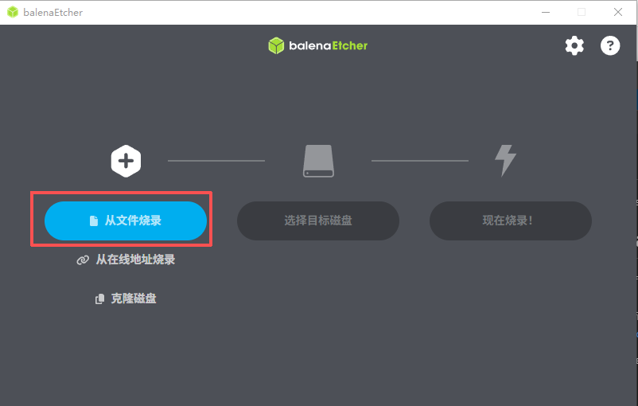
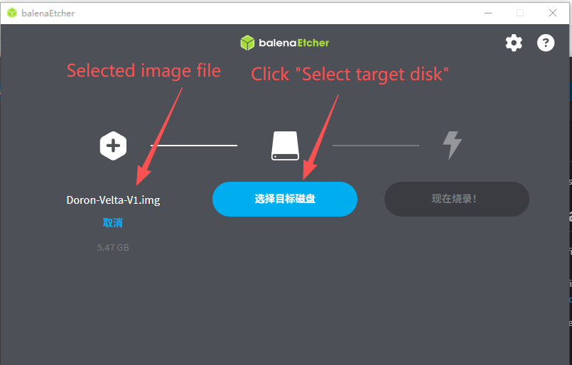
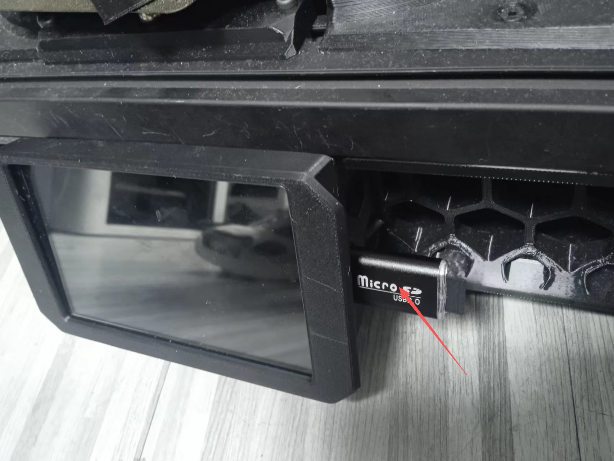

# Introduce
This document explains how to flash and update an image.

# Download firmware and tool
- Download the Fysetc_Venture_Delta-Raspberry_OS-v0.1.img.xz.001 and Fysetc_Venture_Delta-Raspberry_OS-v0.1.img.xz.002 and extract it using 7-Zip.
- Download balenaEtcher, Official Github: https://github.com/balena-io/etcher/releases/tag/v2.1.7

# Flash Image
- Prepare a MicroSD card (minimum 16GB, Class 10 or faster) and connect it to your PC.
- Launch balenaEtcher, click "Flash from file", and select the extracted file.

  

- Select the disk for the inserted SD card.
- Click to burn now

  

Waiting for the burning process to complete.

# Update
- Power off the FYSETC-Doron_Velta machine
- insert the SD card

  

- Power on the device, and a progress bar will appear on the display. The update will take approximately 10 minutes to complete.
- Power off the device and remove the SD card.

# Important
The Wi-Fi network only supports WPA2 encryption.

